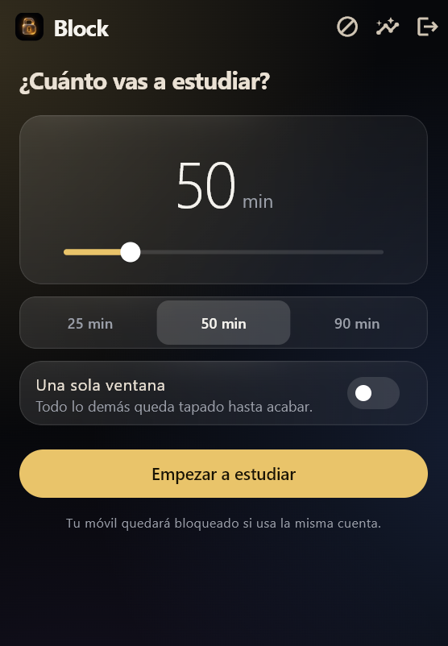
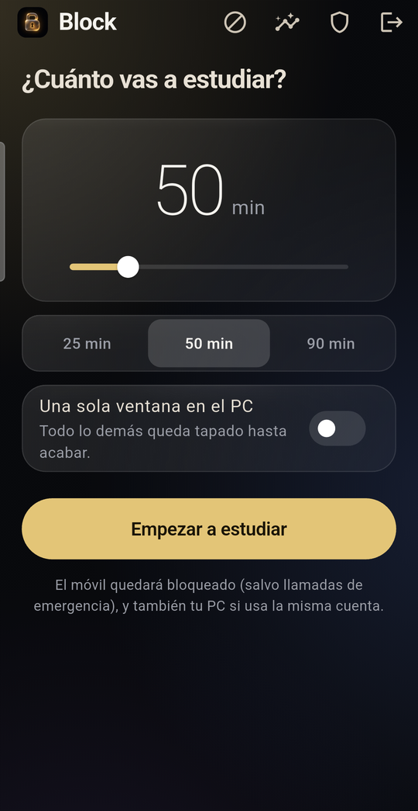

<p align="center">
  
</p>

<h1 align="center">Block</h1>

<p align="center">
  <b>Start studying on your laptop. Your phone locks itself until you're done.</b><br>
  A cross-device focus blocker for Windows + Android.
</p>

<p align="center">
  
  &nbsp;&nbsp;
  
</p>

---

## Why

Most focus apps block one device at a time. You lock your phone, then you open
WhatsApp on the laptop. You block websites on the laptop, then you pick up the
phone.

Block treats your devices as one. When you start a session on the PC:

- **The phone locks completely.** It shows only a countdown, an emergency-call
  button and an emergency exit. This isn't app-by-app blocking.
- **The PC closes distracting apps** (WhatsApp, Discord, Telegram, Spotify,
  Steam…) and **redirects distracting websites**.
- **Optional single-window mode:** click the window you're studying in (your PDF,
  your IDE) and everything else is covered until the session ends.
- **The session ends by itself** at the time set by the server. It works even
  offline, and changing the phone's clock doesn't end it early.

## Built from what people actually complain about

Before writing code I reviewed the existing focus blockers (Freedom, Cold Turkey,
Opal, Forest, AppBlock, Focus Bear…) and what users complain about in their
negative reviews:

| Common complaint | What Block does |
|---|---|
| "Too easy to bypass" (disable accessibility, uninstall, change the clock) | Settings is covered during a session, uninstall is blocked via Device Admin, and the session end time is anchored to a monotonic clock |
| "It worked for a week, then the phone killed it" | Asks for a battery-optimization exemption and shows step-by-step guidance for aggressive OEMs. The lock survives a reboot |
| "I just switch to the other device" | One account links all your devices, so a session started on any of them locks all of them |
| "Too strict, I had a real emergency" / "too easy to quit" | Emergency exit with friction: 60 s of breathing, then type a sentence and pick a reason. It's logged in your history |
| Guilt mechanics (dead trees, lost streaks) | History shows the minutes you studied and nothing else |

The friction-based exit follows research showing that friction *with an option to
quit* reduces impulsive app opens far more than hard blocks or reflective
prompts alone (one sec study, PNAS 2023).

## How it works

```
┌──────────────┐   start_focus_session()   ┌──────────────────┐
│  Windows app │ ────────────────────────▶ │ Supabase         │
│  (Flutter +  │ ◀──── Realtime ────────── │ Postgres + RLS   │
│   Win32 C++) │                           │ sessions via RPC │
└──────┬───────┘                           └────────▲─────────┘
       │ 127.0.0.1                                  │ device_session_state()
┌──────▼───────┐                           ┌────────┴─────────┐
│ Browser ext. │                           │ Android          │
│ (MV3)        │                           │ Accessibility-   │
└──────────────┘                           │ Service (Kotlin) │
                                           └──────────────────┘
```

| Part | Tech | What it does |
|---|---|---|
| App (`app/lib`) | Flutter, Riverpod | UI, sessions, login, block lists, history. One codebase for Android and Windows |
| Android blocker (`app/android/.../blocker`) | Kotlin | `AccessibilityService` + full-screen `TYPE_ACCESSIBILITY_OVERLAY` that sits above everything, Settings included. It checks the session state when the screen turns on and every 2 s while it stays on, so it works even when Flutter isn't running |
| Windows blocker (`app/windows/runner/blocker`) | C++ / Win32 | Process guard, single-window overlay (layered window with a hole, foreground enforcement, low-level keyboard hook for Win/Alt+Tab), tray app, autostart |
| Website blocking (`extension/`) | Chrome/Edge MV3 | `declarativeNetRequest` redirects, driven by a local endpoint exposed by the Windows app |
| Backend (`supabase/migrations`) | Supabase | Sessions can only be created or ended through RPCs, so **the server sets the times**. Each device authenticates with its own secret, so the native Android service never shares the user's refresh token |

### Design decisions worth stealing

- **Lock when you look, not when the server says so.** The phone only needs to
  *look* locked when you pick it up. So instead of push notifications it checks
  on `SCREEN_ON` and polls while the screen is on. No Firebase, and it still
  locks within seconds.
- **Unlocking never needs the network.** Every device stores the server's end
  time anchored to `elapsedRealtime()` / a monotonic stopwatch. It unlocks on
  time even in airplane mode.
- **A Flutter restart can't unlock the phone.** The native side only clears a
  cloud session after the server confirms it ended.

## Running it yourself

1. Create a Supabase project and apply `supabase/migrations`.
2. Create `app/config.json` (it's git-ignored):
   ```json
   { "SUPABASE_URL": "https://<ref>.supabase.co", "SUPABASE_KEY": "<publishable or anon key>" }
   ```
   Without it, Block runs in local-only mode (each device on its own).
3. Build:
   ```bash
   cd app
   flutter build apk --release --dart-define-from-file=config.json      # Android
   flutter build windows --release --dart-define-from-file=config.json  # Windows (needs VS C++ tools)
   ```
4. On Android, grant the three permissions from the in-app setup screen. On
   Android 13+ sideloaded apps first need *"Allow restricted settings"* in App
   info.
5. Load `extension/` as an unpacked extension in Chrome or Edge.

Tests: `flutter analyze && flutter test`.

The UI is in Spanish for now.

## Honest limitations

Block adds **a lot of friction, not absolute security**, the same as every app
in this category:

- **Android:** safe mode disables third-party apps, and Android 17's Advanced
  Protection revokes accessibility access from non-accessibility apps. Google
  Play also restricts accessibility-based blockers, so for now Block is sideloaded.
- **Windows:** Ctrl+Alt+Del / Task Manager can't be intercepted by a user-mode app.

## Status

Personal project, working end-to-end on Windows 11 and a Galaxy A55 (Android 16).
Ideas, issues and PRs are welcome.
